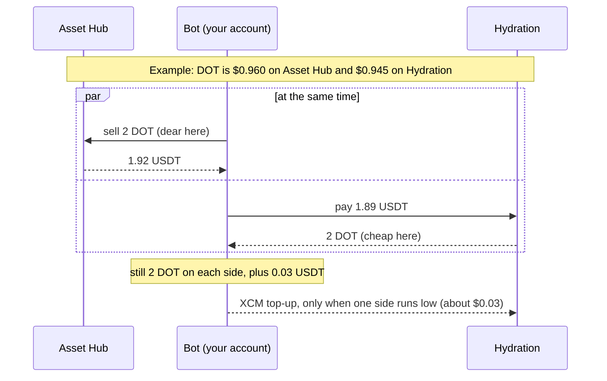
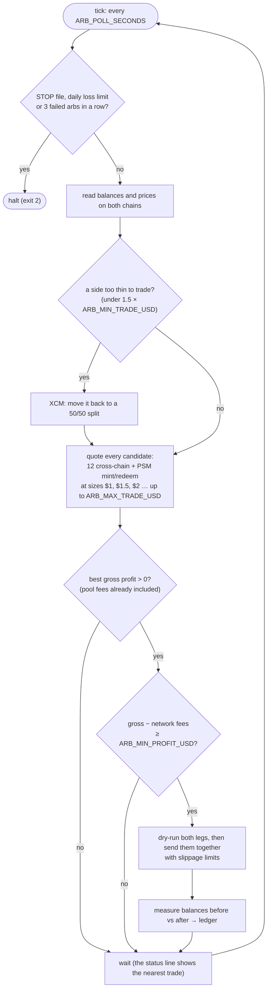
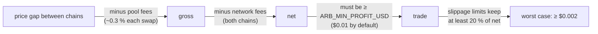

# arb: Asset Hub ⇄ Hydration arbitrage bot

A small bot that trades **live** with real funds. There is no paper mode. It
signs with a mnemonic, keeps inventory on both chains, and only trades when a
trade still clears every fee.

```sh
# once
npm install

# run (or put ARB_MNEMONIC in .env)
ARB_MNEMONIC="word1 word2 … word12" npm start
```

`npm start` runs `node --no-opt`. Without that flag, V8's optimizing compiler
crashes under polkadot-api on Node 20/22 ("Fatal error … unreachable code" in
`turboshaft::BuildGraph`). Don't run `src/main.ts` with plain `tsx` or `node`. When
the bot halts (exit code 2), npm also prints its own "npm error" lines; that's
expected.

Fund the account with USDT on **Polkadot Asset Hub** first, e.g. 40 USDT. The
address is printed at startup, and it is the same account your wallet
extension shows for that mnemonic (sr25519, no derivation path unless you set
`ARB_DERIVATION`).

## How it works (picture version)

The bot keeps a little of each coin on both chains. When the same coin is
cheaper on one chain than on the other, it sells where it's dear and buys back
where it's cheap, both at once. It ends up holding the same coins plus a few
cents.



Result: 1.92 − 1.89 = **0.03 USDT** profit before network fees.

### Every tick



### When a trade is worth it

Each check has to pass before anything is sent:



Spreads big enough to pass are rare, so expect the bot to sit idle most of the
time (see [Expect it to sit idle](#expect-it-to-sit-idle)).

## What it does

**1. Setup (first run only).** It turns the deposit into even inventory: about
1/6 of the equity in each of DOT, USDT and USDC on each chain. It buys DOT and
USDC on Asset Hub (the first swap pays its fee in USDT, because the account
holds no DOT yet), sends half of each asset to Hydration over XCM, and sets
Hydration's fee currency to DOT. Setup tops up only what is missing, so it is
safe to restart midway.

**2. Every tick (12 s).** It reads balances and prices on both chains and
quotes every candidate:

| Loop | What happens | Atomic? |
|---|---|---|
| **xchain** | Sell X for Y on the chain where X is dear and buy the same X back with Y where it is cheap, at the same time, from inventory on both chains. All six ordered pairs of DOT/USDT/USDC in both chain directions. The profit is the Y left over. | No. Both legs are dry-run first, then submitted together. Each leg's slippage limit is set so the pair still breaks even if both fill at their worst price. |
| **psm-mint** | USDT → PSM mint → dotUSD → sell on the pool for USDT (when dotUSD trades above $1) | Yes, one `utility.batch_all` |
| **psm-redeem** | USDT → buy dotUSD on the pool → PSM redeem → USDT (when dotUSD trades below $1) | Yes, one `utility.batch_all` |

The search starts at the minimum size and walks up a size ladder ($1 … $5) for
as long as the profit grows. For the best candidate it estimates the real
network fees of the actual transactions. It executes only if
**gross − fees ≥ `ARB_MIN_PROFIT_USD`**. Every transaction is dry-run on chain
before it is signed.

**3. Rebalancing.** When trades leave one side of an asset too thin to fund a
minimum trade (under 1.5 × min size), it sends that asset back to a 50/50 split
over XCM. It moves inventory only when it has to, because each XCM costs about
$0.03.

## P&L

Every action is **measured**, not estimated. The bot reads balances on both
chains before and after the action and values the difference at the prices from
before it. That gives what the action really earned or cost, with every fee
included (pool, PSM, tx fees on both chains, XCM delivery and execution) and
market moves left out.

```
  Equity $39.71 (DOT $0.9286)  P&L -$0.29 = arb +$0.03 · setup -$0.24 · rebalance -$0.03 · market -$0.05
```

- **total**: equity now minus equity at the first funded run (the baseline)
- **arb**: the measured result of every arb, including failed ones
- **setup / rebalance**: what inventory management cost
- **market**: the rest, i.e. holding DOT while its price moves

`data/state.json` holds the running totals. `data/ledger.jsonl` has one
line per action: the expected and realized amounts, the tx hashes, and the
balances before and after. Delete both files to start a fresh baseline.

## Stopping

- **Ctrl+C**: finishes the current action, prints the final table, then exits.
  Press it twice to force. `SIGTERM` (e.g. `systemctl stop`) and `SIGHUP` (the
  terminal closing) stop it the same way.
- **Kill switch**: `touch data/STOP` (the bot halts at the next tick and
  refuses to start while the file exists), or `ARB_KILL=1`.
- **Automatic halts**: the daily loss limit (`ARB_MAX_DAILY_LOSS_USD`, counting
  arbs and rebalances in the current UTC day), 3 failed arbs in a row, or an XCM
  that has not arrived after 10 minutes.

## Settings

All settings come from the environment (or `.env`):

| Variable | Default | |
|---|---|---|
| `ARB_MNEMONIC` | required | signing account |
| `ARB_DERIVATION` | none | derivation path |
| `ARB_MIN_PROFIT_USD` | `0.01` | net profit after tx fees needed to trade |
| `ARB_MIN_TRADE_USD` | `1` | smallest trade; also the rebalance trigger (a side under 1.5×) |
| `ARB_MAX_TRADE_USD` | `5` | largest trade; capped in practice by the inventory on each chain |
| `ARB_MAX_DAILY_LOSS_USD` | `2` | halt when arbs + rebalances lose this much in a UTC day |
| `ARB_POLL_SECONDS` | `12` | time between checks |
| `ARB_SUMMARY_EVERY` | `25` | plain mode only: print the balance table every N idle ticks |
| `ARB_ASSETHUB_RPC` / `ARB_HYDRATION_RPC` | public endpoints | RPC URLs |
| `ARB_DATA_DIR` | `./data` | ledger, state and the `STOP` file |
| `ARB_KILL` | none | `1` refuses to run |
| `ARB_PLAIN` | none | `1` turns off the live status lines |
| `ARB_CHART_MINUTES` | `5` | how much history the live charts show; `0` hides them |
| `ARB_CHART_HEIGHT` | `8` | rows for the price chart (the trade chart gets ~60 %); `1` = one-line sparklines |
| `ARB_ASCII` | none | `1` prints plain ASCII only, for fonts that show boxes |

## Screen output

On a terminal, the bottom of the screen is a live status that redraws in
place every second instead of printing a line every tick:

```
● LIVE #482 up 1h36m · DOT $0.9526 AH / $0.9519 HY (-0.07%) · next check 4s
  nearest trade -$0.0123 DOT/USDT sell AH→buy HY · best since start -$0.0040 at 14:02
  equity $40.12 · P&L -$0.07 · today  $0.00 (halt at −$0.5) · arbs 0 · last trade none yet
  DOT price   ● Asset Hub   ● Hydration   ◆ both
   $0.9532 ┤      ●◆◆◆◆●●●●●
           ┤    ◆◆●    ●●   ●●●                             ●●
           ┤ ●●◆         ●     ●●●                       ●●●
   $0.9519 ┤●●●           ●●      ●●                   ●●    ●
           ┤●               ●●      ●●●             ●●●     ●
           ┤                  ●●      ●◆◆◆◆◆◆●◆●●●●●      ●●
           ┤                    ●●●●●●       ● ●●●      ●●
   $0.9501 ┤                                      ●●●●●●
           └──────────────────────────────────────────────────
            -5m                                            now
  nearest trade gross, before network fees · trades only above $0 + fees
   +$0.010 ┤                                       ███
    $0.000 ┤┄┄┄┄┄┄┄┄┄┄┄┄┄┄┄┄┄┄┄┄┄┄┄┄┄┄┄┄┄┄┄┄┄┄┄┄┄┄┄███┄┄┄┄┄┄┄┄
           ┤█████       ████████████████████████        ██████
           ┤█               ████████████████               ███
   -$0.045 ┤                    ████████
           └──────────────────────────────────────────────────
            -5m                                            now
```

How to read the charts (newest on the right):

- **DOT price**: DOT on Asset Hub and on Hydration on one shared scale. The
  vertical distance between the two lines is the arbitrage gap. ◆ marks where
  both prices are equal.
- **nearest trade**: the best candidate's gross profit each tick, as bars
  around the $0 line. Bars hang below $0 while nothing pays. Bars that rise
  above it turn green but still need to clear network fees and
  `ARB_MIN_PROFIT_USD` before a trade happens.

The charts shrink to fit the window. With little room they turn into one-line
sparklines, and if even that doesn't fit they are hidden. Set
`ARB_CHART_HEIGHT=1` to always use sparklines, or a higher number for taller
charts.

### Boxes instead of symbols (PuTTY, mRemoteNG)

If the charts show as empty squares, the terminal's font lacks those
characters. Either:

- **Fix the font** (recommended). In mRemoteNG: *Tools → Options → Advanced →
  Launch PuTTY*, load the session that mRemoteNG uses (*Default Settings*
  unless you set one), then set *Window → Appearance → Font* to **Consolas**
  or **Cascadia Mono** and *Window → Translation → Remote character set* to
  **UTF-8**. Click *Save*.
- **Or use a better client**: Windows Terminal (built into Windows 11, and in
  the Store for 10) renders everything out of the box: `ssh pi@raspberrypi.local`.
- **Or set `ARB_ASCII=1`**, which draws everything with plain ASCII
  (`o`/`x` points, `#` bars, `|` and `-` axes) and works in any font.

When stdout is not a terminal (a log file, systemd/journald) or `ARB_PLAIN=1`,
it prints one line per tick, as before.

## Running on a server (e.g. a Raspberry Pi over SSH)

Closing the SSH session sends `SIGHUP`. The bot finishes its current action
and stops. To keep it running after you disconnect, start it inside tmux:

```sh
tmux new -s arb          # start a session
npm start                # run the bot
# detach: Ctrl+B then D. Later, after you SSH back in:
tmux attach -t arb
```

The bot warns at startup if it runs over SSH outside tmux or screen.

## Expect it to sit idle

When this was written, Asset Hub DOT/USDT was at $0.9286. Hydration quoted
$0.9263 to sell 2 DOT and $0.9321 to buy 2 DOT. A cross-chain round trip pays
about 0.3 % on Asset Hub plus Hydration's route fee, so it needs a spread above
roughly 0.6–0.8 %. The PSM loop needs dotUSD more than about 0.6 % off peg,
because it crosses two pool hops through DOT. Spreads that large are rare, and
the bot correctly does nothing most of the time. Raising `ARB_MAX_TRADE_USD`
lets it take more of a spread when one shows up. Lowering `ARB_MIN_PROFIT_USD`
does not create trades: the hard floor is still "net > fees".

## Chain facts this relies on (verified 2026-11-03)

- Asset Hub: USDT = Assets 1984, USDC = 1337, dotUSD = 7873 (PSM internal
  asset, external: USDT only, mint fee 0 %, redeem fee 0.01 %, min swap 1).
  Every pool pairs with DOT.
- Hydration: DOT = 5, USDT = 10, USDC = 22. dotUSD is not registered, so PSM
  legs stay on Asset Hub.
- XCM: `PolkadotXcm.transfer_assets_using_type_and_then`. Asset Hub → Hydration
  uses LocalReserve and Hydration → Asset Hub uses DestinationReserve, with at
  most 2 assets per message. Both directions were dry-run end to end for every
  asset (source `dry_run_call`, then destination `dry_run_xcm`). Plain
  `transfer_assets` refuses DOT (`InvalidAssetUnknownReserve`).

## Code

| File | |
|---|---|
| `src/main.ts` | config, the loop, the status output |
| `src/strategy.ts` | candidate search, sizing, rebalance planning (pure; specs use fake quotes) |
| `src/executor.ts` | setup, arb execution with limits, XCM with arrival tracking, measured actions |
| `src/venues.ts` | Asset Hub pools + PSM, Hydration router, XCM builders |
| `src/chains.ts` | connections, key, balances, prices, dry-run-then-send |
| `src/pnl.ts` | ledger and P&L split |
| `src/log.ts`, `src/chart.ts` | output, the live status region, sparklines |

`npm test` runs the specs (no network).
