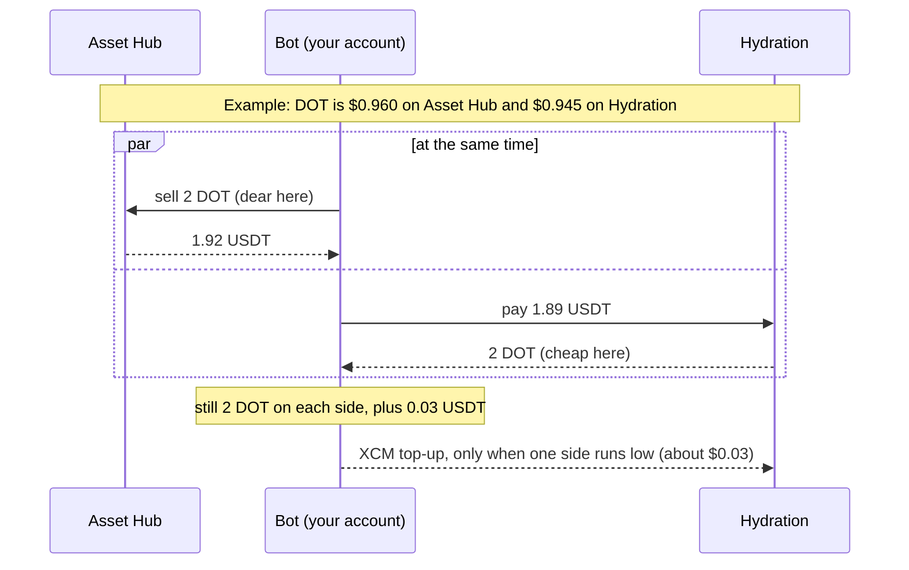
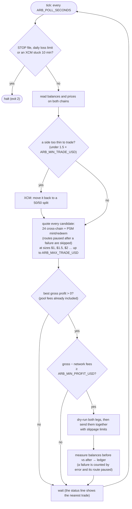
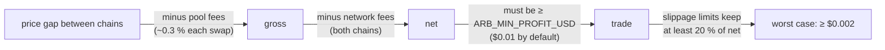

# arb: Asset Hub ⇄ Hydration arbitrage bot

A small bot that trades **live** with real funds. There is no paper mode. It
signs with a mnemonic, keeps inventory on both chains, and only trades when a
trade still clears every fee.

```sh
# once
npm install

# run (or put ARB_MNEMONIC in .env)
ARB_MNEMONIC="word1 word2 … word12" npm start
```

`npm start` runs `node --no-opt`. Without that flag, V8's optimizing compiler
crashes under polkadot-api on Node 20/22 ("Fatal error … unreachable code" in
`turboshaft::BuildGraph`). Don't run `src/main.ts` with plain `tsx` or `node`. When
the bot halts (exit code 2), npm also prints its own "npm error" lines; that's
expected.

Fund the account with USDT on **Polkadot Asset Hub** first, e.g. 40 USDT. The
address is printed at startup, and it is the same account your wallet
extension shows for that mnemonic (sr25519, no derivation path unless you set
`ARB_DERIVATION`).

## How it works (picture version)

The bot keeps a little of each coin on both chains. When the same coin is
cheaper on one chain than on the other, it sells where it's dear and buys back
where it's cheap, both at once. It ends up holding the same coins plus a few
cents.



Result: 1.92 − 1.89 = **0.03 USDT** profit before network fees.

### Every tick



### When a trade is worth it

Each check has to pass before anything is sent:



Spreads big enough to pass are rare, so expect the bot to sit idle most of the
time (see [Expect it to sit idle](#expect-it-to-sit-idle)).

## What it does

**1. Setup (first run only).** It turns the deposit into even inventory: about
1/8 of the equity in each of DOT, USDT, USDC and ETH on each chain. It buys
DOT, USDC and ETH with USDT on Asset Hub (the first swap pays its fee in USDT,
because the account holds no DOT yet), sends half of each asset to Hydration
over XCM, and sets Hydration's fee currency to DOT. Setup tops up only what is
missing, so it is safe to restart midway. An asset added later (ETH, for an
account set up before it was added) is set up on its own at the next start,
using only the USDT the account can spare.

**2. Every tick (12 s).** It reads balances and prices on both chains and
quotes every candidate:

| Loop | What happens | Atomic? |
|---|---|---|
| **xchain** | Sell X for Y on the chain where X is dear and buy the same X back with Y where it is cheap, at the same time, from inventory on both chains. All twelve ordered pairs of DOT/USDT/USDC/ETH in both chain directions. The profit is the Y left over. | No. Both legs are dry-run first, then submitted together. Each leg's slippage limit is set so the pair still breaks even if both fill at their worst price. |
| **psm-mint** | USDT → PSM mint → dotUSD → sell on the pool for USDT (when dotUSD trades above $1) | Yes, one `utility.batch_all` |
| **psm-redeem** | USDT → buy dotUSD on the pool → PSM redeem → USDT (when dotUSD trades below $1) | Yes, one `utility.batch_all` |

The search starts at the minimum size and walks up a size ladder ($1 … $5) for
as long as the profit grows. For the best candidate it estimates the real
network fees of the actual transactions. It executes only if
**gross − fees ≥ `ARB_MIN_PROFIT_USD`**. Every transaction is dry-run on chain
before it is signed.

**3. Rebalancing.** When trades leave one side of an asset too thin to fund a
minimum trade (under 1.5 × min size), it sends that asset back to a 50/50 split
over XCM. It moves inventory only when it has to, because each XCM costs about
$0.03.

## P&L

Every action is **measured**, not estimated. The bot reads balances on both
chains before and after the action and values the difference at the prices from
before it. That gives what the action really earned or cost, with every fee
included (pool, PSM, tx fees on both chains, XCM delivery and execution) and
market moves left out.

```
  Equity $39.71 (DOT $0.9286)  P&L -$0.29 = arb +$0.03 · setup -$0.24 · rebalance -$0.03 · market -$0.05
```

- **total**: equity now minus equity at the first funded run (the baseline)
- **arb**: the measured result of every arb, including failed ones
- **setup / rebalance**: what inventory management cost
- **market**: the rest, i.e. holding DOT while its price moves

`data/state.json` holds the running totals. `data/ledger.jsonl` has one
line per action: the expected and realized amounts, the tx hashes, and the
balances before and after. Delete both files to start a fresh baseline.

## Stopping

- **Ctrl+C**: finishes the current action, prints the final table, then exits.
  Press it twice to force. `SIGTERM` (e.g. `systemctl stop`) and `SIGHUP` (the
  terminal closing) stop it the same way.
- **Kill switch**: `touch data/STOP` (the bot halts at the next tick and
  refuses to start while the file exists), or `ARB_KILL=1`.
- **Automatic halts**: the daily loss limit (`ARB_MAX_DAILY_LOSS_USD`, counting
  arbs and rebalances in the current UTC day) or an XCM that has not arrived
  after 10 minutes. Failed trades do **not** stop the bot (see
  [Errors](#errors)).

## Errors

A failed trade is logged, counted and kept running past:

- The ledger counts every failure by kind, stage and error name (e.g.
  `AssetConversion.ProvidedMinimumNotSufficientForSwap`), with its measured
  cost. The live status shows the two most frequent.
- **dry-run** failures sent nothing and cost nothing. **on-chain** failures
  were included in a block and paid their fees.
- The route that failed is paused: 1 minute after the first failure, doubling
  with each failure in a row up to 30 minutes, cleared by a success. A broken
  route can't burn fees every tick, and the other routes keep trading. The
  daily loss limit is the backstop.
- `npm run errors` lists every failure group (count, cost, first and last time,
  the last message in full) and the most recent failures, from the ledger
  alone. `npm run errors -- 30` shows the last 30.

## Settings

All settings come from the environment (or `.env`):

| Variable | Default | |
|---|---|---|
| `ARB_MNEMONIC` | required | signing account |
| `ARB_DERIVATION` | none | derivation path |
| `ARB_MIN_PROFIT_USD` | `0.01` | net profit after tx fees needed to trade |
| `ARB_MIN_TRADE_USD` | `1` | smallest trade; also the rebalance trigger (a side under 1.5×) |
| `ARB_MAX_TRADE_USD` | `5` | largest trade; capped in practice by the inventory on each chain |
| `ARB_MAX_DAILY_LOSS_USD` | `2` | halt when arbs + rebalances lose this much in a UTC day |
| `ARB_POLL_SECONDS` | `12` | time between checks |
| `ARB_SUMMARY_EVERY` | `25` | plain mode only: print the balance table every N idle ticks |
| `ARB_ASSETHUB_RPC` / `ARB_HYDRATION_RPC` | public endpoints | RPC URLs |
| `ARB_DATA_DIR` | `./data` | ledger, state and the `STOP` file |
| `ARB_KILL` | none | `1` refuses to run |
| `ARB_PLAIN` | none | `1` turns off the live status lines |
| `ARB_CHART_MINUTES` | `5` | how much history the live charts show; `0` hides them |
| `ARB_CHART_HEIGHT` | `8` | rows for the price chart (the trade chart gets ~60 %); `1` = one-line sparklines |
| `ARB_ASCII` | none | `1` prints plain ASCII only, for fonts that show boxes |
| `ARB_BOARD_ROWS` | `5` | routes shown on the board; `0` hides it |

## Screen output

On a terminal, the bottom of the screen is a live status that redraws in
place every second instead of printing a line every tick:

```
● LIVE #150 up 15m · DOT $0.9531 AH / $0.9524 HY (-0.07%) · next check 4s
  nearest trade -$0.0035 DOT/USDT sell AH→buy HY · best since start +$0.0021 at 14:02
  equity $40.12 · P&L -$0.07 · today  $0.00 (halt at −$2) · arbs 2 (1 failed) · last trade 13:40 ok
  errors 3× AssetConversion.ProvidedMinimumNotSufficientForSwap (on-chain -$0.011) · 1× Token.FundsUnavailable (dry-run) · npm run errors
  routes gross now · last 15m · best
  -$0.0054  ETH/DOT sell HY→buy AH    ▁▁▁▃▅▇█▆▃▁▁▁▁▁▁▁▁▁▁▁▁▁▁▁▁▁▂▄▆█▇▄▂  best +$0.0060
  -$0.0062  psm-redeem                ▃▄▄▄▅▅▅▅▄▄▄▃▃▂▂▁▁▁▁▁▁▂▂▃▃▄▄▅▅▅▅▅▄  best -$0.0050
  -$0.0062  DOT/USDT sell AH→buy HY   ▄▆▇▇▆▅▄▃▁▁▁▂▄▅▆▇▇▆▅▃▂▁▁▂▃▅▆▇▇▆▅▄▂  best -$0.0010  paused 3m
  -$0.0078  DOT/USDC sell HY→buy AH   ▃▃▃▄▄▄▄▄▄▄▄▄▃▃▃▂▂▂▁▁▁▁▁▁▁▁▂▂▂▃▃▃▄  best -$0.0070
  -$0.0087  USDT/USDC sell AH→buy HY  ▄▄▅▅▆▆▅▅▄▃▂▂▁▁▁▁▂▃▄▄▅▅▆▆▅▅▄▃▂▂▁▁▁  best -$0.0030
  DOT price   ● Asset Hub   ● Hydration   ◆ both
   $0.9532 ┤        ●●◆◆◆◆◆◆●●●●●●●
           ┤     ◆◆◆●●      ●●●    ●●●●●                                           ●●●●
           ┤ ●●◆◆              ●●       ●●●●                                   ●●●●
   $0.9519 ┤● ●                  ●●         ●●●●                           ●●●●      ●●
           ┤●●                     ●●●          ●●●●                   ●●●●        ●●
           ┤                          ●●●●        ●●◆◆◆◆◆◆◆◆◆●◆◆●●●●●●●          ●●
           ┤                              ●●●●●●●●           ●  ●●●●●         ●●●
   $0.9501 ┤                                                         ●●●●●●●●●
           └───────────────────────────────────────────────────────────────────────────
            -15m                                                                    now
  nearest trade gross, before network fees · trades above +$0.014 (fees + min profit)
    $0.000 ┤┄┄┄┄┄┄┄┄┄┄┄┄┄┄┄┄┄┄┄┄┄┄┄┄┄┄┄┄┄┄┄┄┄┄┄┄┄┄┄┄┄┄┄┄┄┄┄┄┄┄┄┄┄┄┄┄┄┄┄┄┄┄┄┄┄┄┄┄┄┄┄┄┄┄┄
           ┤███████████████████████████████████████████████████████████████████████████
           ┤███         ███████████████████         ███████████████████          ██████
           ┤                ████████████               ██                          ████
   -$0.007 ┤                    ██████                                                █
           └───────────────────────────────────────────────────────────────────────────
            -15m                                                                    now
```

How to read it (newest on the right):

- **routes**: every route the bot quotes, closest to profitable first. Each
  row shows the gross now, a sparkline of the window, and the best in the
  window. Bars are green above $0 and yellow once they clear the "needed"
  line, where a trade goes ahead. A route paused after a failure says
  `paused Nm`.
- **errors**: the two most frequent failures, with their stage and cost
  (shown only once something has failed).
- **DOT price**: DOT on Asset Hub and on Hydration on one shared scale. The
  vertical distance between the two lines is the arbitrage gap. ◆ marks where
  both prices are equal.
- **nearest trade**: the best tradeable route's gross profit each tick, as
  bars around the $0 line. The title gives what a trade needs: the network
  fees of a typical round trip (estimated every 10 minutes from real
  transactions, nothing sent) plus `ARB_MIN_PROFIT_USD`. When that level is
  inside the chart it is drawn as a dotted line.

`npm run preview` draws this screen once from made-up data, without
connecting to anything. Try `COLUMNS=60 LINES=24 npm run preview` or
`ARB_ASCII=1 npm run preview` to see other sizes and modes.

The board and charts shrink to fit the window. With little room the charts
turn into one-line sparklines, and if even that doesn't fit they are hidden. Set
`ARB_CHART_HEIGHT=1` to always use sparklines, or a higher number for taller
charts.

### Boxes instead of symbols (PuTTY, mRemoteNG)

If the charts show as empty squares, the terminal's font lacks those
characters. Either:

- **Fix the font** (recommended). In mRemoteNG: *Tools → Options → Advanced →
  Launch PuTTY*, load the session that mRemoteNG uses (*Default Settings*
  unless you set one), then set *Window → Appearance → Font* to **Consolas**
  or **Cascadia Mono** and *Window → Translation → Remote character set* to
  **UTF-8**. Click *Save*.
- **Or use a better client**: Windows Terminal (built into Windows 11, and in
  the Store for 10) renders everything out of the box: `ssh pi@raspberrypi.local`.
- **Or set `ARB_ASCII=1`**, which draws everything with plain ASCII
  (`o`/`x` points, `#` bars, `|` and `-` axes) and works in any font.

When stdout is not a terminal (a log file, systemd/journald) or `ARB_PLAIN=1`,
it prints one line per tick, as before.

## Running on a server (e.g. a Raspberry Pi over SSH)

Closing the SSH session sends `SIGHUP`. The bot finishes its current action
and stops. To keep it running after you disconnect, start it inside tmux:

```sh
tmux new -s arb          # start a session
npm start                # run the bot
# detach: Ctrl+B then D. Later, after you SSH back in:
tmux attach -t arb
```

The bot warns at startup if it runs over SSH outside tmux or screen.

## ETH

ETH (Snowbridge ether) trades like the other assets. On Asset Hub it is a
ForeignAssets asset with its own DOT/ETH pool, which is small (about $4.6k on
2026-11-04): 0.34 % to swap $1, 0.51 % for $5. So prices there move fast, and
only small sizes pay. On Hydration it is asset 34, routed through the Aave
money market.

- Setup buys it with USDT (USDT → DOT → ETH on Asset Hub) and sends half to
  Hydration. An account set up before ETH was added gets it at the next start,
  using only spare USDT on Asset Hub. To fully stock it, add USDT first and
  record the deposit (see [Adding funds](#adding-funds)).
- **ETH always travels in its own XCM message.** Its paths were verified
  (`npm run verify-xcm -- ETH`, 2026-11-05) in both directions as a
  single-asset message, paying its own destination fee in ETH. ETH paired with
  DOT could not be checked from Hydration.
- Reserve kept back: 0.00003 ETH on Asset Hub, 0.000011 on Hydration (twice
  each chain's existential deposit).

## Adding funds

Send USDT to the account on Asset Hub, then, with the bot stopped:

```sh
npm run deposit -- 10     # the USD you added (negative for a withdrawal)
npm start
```

`deposit` raises the P&L baseline, so the new money isn't counted as profit.
At start the bot sets up any asset it holds too little of.

## Expect it to sit idle

When this was written, Asset Hub DOT/USDT was at $0.9286. Hydration quoted
$0.9263 to sell 2 DOT and $0.9321 to buy 2 DOT. A cross-chain round trip pays
about 0.3 % on Asset Hub plus Hydration's route fee, so it needs a spread above
roughly 0.6–0.8 %. The PSM loop needs dotUSD more than about 0.6 % off peg,
because it crosses two pool hops through DOT. Spreads that large are rare, and
the bot correctly does nothing most of the time. Raising `ARB_MAX_TRADE_USD`
lets it take more of a spread when one shows up. Lowering `ARB_MIN_PROFIT_USD`
does not create trades: the hard floor is still "net > fees".

## Chain facts this relies on (verified 2026-11-03)

- Asset Hub: USDT = Assets 1984, USDC = 1337, dotUSD = 7873 (PSM internal
  asset, external: USDT only, mint fee 0 %, redeem fee 0.01 %, min swap 1).
  Every pool pairs with DOT.
- Reads (quotes, balances, PSM state, dry runs) target the **best** block, not
  the finalized one that polkadot-api uses by default. Finalized was 12 blocks
  behind best when checked. Quotes from there show spreads that someone has
  already closed, and the swap then fails on chain with
  `AssetConversion.ProvidedMinimumNotSufficientForSwap` (the slippage limit),
  paying its fee.
- Asset Hub ETH: ForeignAssets, location `{ parents: 2, GlobalConsensus(Ethereum { chain_id: 1 }) }`, min balance 0.000015.
- Hydration: DOT = 5, USDT = 10, USDC = 22, ETH = 34 (existential deposit 0.0000054). dotUSD is not registered, so PSM
  legs stay on Asset Hub.
- XCM: `PolkadotXcm.transfer_assets_using_type_and_then`. Asset Hub → Hydration
  uses LocalReserve and Hydration → Asset Hub uses DestinationReserve, with at
  most 2 assets per message, and ETH on its own. Both directions were dry-run
  end to end for every asset (source `dry_run_call`, then destination
  `dry_run_xcm`); `npm run verify-xcm -- <ASSET>` repeats that check. Plain
  `transfer_assets` refuses DOT (`InvalidAssetUnknownReserve`).

## Code

| File | |
|---|---|
| `src/main.ts` | config, the loop, the status output |
| `src/strategy.ts` | candidate search, sizing, rebalance planning (pure; specs use fake quotes) |
| `src/executor.ts` | setup, arb execution with limits, XCM with arrival tracking, measured actions |
| `src/venues.ts` | Asset Hub pools + PSM, Hydration router, XCM builders |
| `src/chains.ts` | connections, key, balances, prices, dry-run-then-send |
| `src/pnl.ts` | ledger and P&L split |
| `src/log.ts`, `src/chart.ts` | output, the live region mechanics, plots and sparklines |
| `src/dashboard.ts`, `src/preview.ts` | what the live status shows; `npm run preview` draws it from fake data |
| `src/errors.ts` | `npm run errors`: failures from the ledger |
| `src/deposit.ts` | `npm run deposit -- <usd>`: record funds added or taken out |
| `src/verify-xcm.ts` | `npm run verify-xcm -- <ASSET>`: read-only dry runs of every XCM path |

`npm test` runs the specs (no network).
